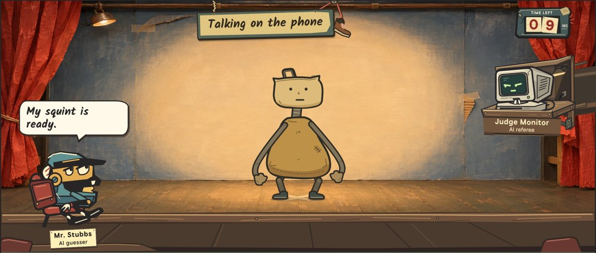

# Bad Actors

The community hall is one actor short. A canvas stage weight is covering the part. Pose the understudy so someone can guess what it is doing.

Choose **Play with AI** and a stagehand lowers your cue on a plank tied to an old boot. You get 45 seconds to act it out. Mr. Stubbs, a ticket punch in the front row, gets five looks. Pose the understudy and hold still. The clock pauses while he thinks. He raises a glove and gives his guess. Judge Monitor prints the ruling from a window in the right wing. **What Stubbs saw** keeps the pictures and the exact guesses for the current round.

A hit brings streamers, a shower of used tickets and two spectators who clap out of time. A miss gets one half-hearted party horn and a heckle from the cheap seats. Turn on **Crowd sound** at the stage desk to hear them. You can try both reactions for free in the opening phone puzzle. Enter `phone call` for applause, or reload the opening and enter `baking bread` to meet the heckler.

You can also guess the opening act yourself or take **Your turn** to play one of six cues with a friend. **Choose a cue** jumps straight to an exercise. **Acting hint** shows an achievable pose. **Hide cue** covers the slip and puts away both the hint and the cue list before you hand over the screen.

Try the two phone cues back to back. For a call, tuck the phone against an ear. For a selfie, drag the phone itself high and to one side. The wrist follows, the screen turns toward the actor and its eyes follow the phone. Give the empty hand a peace sign. Cup, phone and serving tray can all be picked up, carried and passed to the other hand.



[Watch Stubbs guess and the judge print a ruling in a local browser test](docs/verification/stubbs-delivery/stubbs-speaks.gif) · [Six poses made on the stage](docs/verification/six-poses-2026-11-23/six-poses.png) · [Five-second cup and hand take](docs/sandbag-take.gif) · [Watch a foot pull the actor off balance](docs/leg-recoil.gif)

### Run the rehearsal

Use a supported Node 22.15+, 24 or 26 release with npm 11.6+.

```sh
npm ci
npm run practice
```

Open the local URL printed by Vite. This command starts free practice and pass-the-screen play. The local link http://127.0.0.1:5173/?cue=3 opens the selfie exercise directly. Keyboard players can tab to a handle and use the arrow keys. Hold Shift for larger steps.

For the live audience on the project Mac, double-click **Play-Bad-Actors.command** in Finder. Alternatively run:

```sh
npm run practice:ai
```

The launcher reads the operator's existing server-side profile. On another computer, set `BAD_ACTORS_AI_PROFILE` to an absolute path to a private env file outside the project with `OPENAI_BASE_URL` and `OPENAI_API_KEY`. The tested model is `gpt-6.2-sol`. Keep the terminal open during play.

Both roles default to `gpt-6.2-sol`, which has read actual stage poses and scored paraphrases in this game. The local gateway's saved catalog also listed `gpt-6.1-terra`, a candidate for the picture reader. Its recognition rate and response time on our puppet remain unmeasured. To try Terra with the current Sol referee, start a rehearsal with:

```sh
BAD_ACTORS_VISION_MODEL=gpt-6.1-terra BAD_ACTORS_REFEREE_MODEL=gpt-6.2-sol npm run practice:ai
```

These settings also work in the private profile. The shell takes precedence for each setting. `BAD_ACTORS_AI_MODEL` sets the shared fallback. Restart the AI rehearsal to apply a change. [Terra model card](https://developers.openai.com/api/docs/models/gpt-6.1-terra) · [Sol model card](https://developers.openai.com/api/docs/models/gpt-6.2-sol)

Opening the game and drawing a cue are free. Hold a changed pose still or press **Guess this pose** to send it. For untimed rehearsal, choose a card yourself, then **Try this cue with AI**. One model call sees only the frozen actor and prop. A second call sees the assigned action and the first model's guess and scores their meaning. Each round permits five pictures, with daily limits of 12 per local browser session and 24 across the local app. Browsing the observation history reuses the results.

Grab any part of the actor on the same stage. Pull a boot sharply upward and let go. The knee folds, the hips shift and the neck catches up. Try the same pull at the shoulder to feel how the weight travels differently. Slow drags let you place a joint precisely. Each hand has its own illustrated row of four shapes. If it is holding a prop, select the shape you want it to take when you put the prop down. Choose **Side-eye** or **Bracing** to see how the same pose reads with a different expression.

To compare the controls, open **How to play → Compare the feel**. Try lifting one hand, bringing the cup to the mouth, and stopping a quick wave in each mode. **Body follow** lets the torso and head settle after the hand stops. **Direct only** keeps the torso still.

```sh
npm run validate
npm run lint
npm run build:practice
```

### Project status

The single-player AI game runs locally through the configured third-party OpenAI-compatible service. In actual referee calls, Sol accepted both “make a call” and “call sombody” for the phone cue. The opening audience puzzle uses a fixed practice cue. In an earlier blind test Sol described the eye-covering pose as “Rubbing both eyes,” which prompted separate open-palm and fist controls. Hosted multiplayer and voice remain pending. The first DeepSpace deployment is waiting for app quota.

[Verification and receipts](docs/VERIFICATION.md) · [Implementation guide](docs/Bad_Actors_Codex_Plan.md)

### Where the actor came from

Canvas weights steady lighting stands and scenery. That gave the understudy its job, its lopsided shape and its predicament. The one thing employed to keep a stage steady can barely stay upright. The taped flats and single work light belong to the same community hall. [PRG’s stage weights](https://www.prg.com/-/media/Files/Australia/Stage-Fabrics/Shotbags_and_Sandbags.pdf) · [Theatre Calgary’s guide to *The Play That Goes Wrong*](https://www.theatrecalgary.com/assets/downloads/Play-Guides/The-Play-That-Goes-Wrong_TCPlay-Guide.pdf)

The five-second take gives the actor one ordinary job. Let it finish taking a sip before the other hand flies up. The still cup is how the audience can see the rest of the body struggling. That timing owes something to Jacques Tati’s determined postman and *Octodad*’s attempts at everyday tasks. [Criterion on *Jour de fête*](https://www.criterion.com/films/28114-jour-de-fete) · [Young Horses on *Octodad*](https://blog.playstation.com/?p=130022)

The shoulders react first, the weight lands on a boot and the head finishes a beat late. The eyes and mouth remain quiet enough that the audience can read the effort in the silhouette. [National Theatre’s puppet lesson on weight](https://www.youtube.com/watch?v=vXT3gPef8zo) · [Disney’s guide to follow-through](https://a.dolimg.com/media/en-US/disneyeducationalproductions/noma/pdf/DE1775_NOMA_TG.pdf)

### The printed programme

The title keeps its hand-cut letters. Coral and carmine ink fill BAD, turquoise and petrol blue fill ACTORS, and one amber spray mark catches the falling S. The lettering references New York wall pieces and the layered print marks in the Spider-Verse titles. A sharp pull leaves two short strokes behind the moving grip. The curtain and cardboard flats share an original image-generated backdrop. The articulated actor and its prop are separate from the scenery for dragging and for clean visual observations. [The Wild Style mural](https://www.mcny.org/event/new-york-film-wild-style) · [Spider-Verse title design](https://www.seojinbang.com/Spider-Man-Into-the-Spider-Verse) · [Pollock’s toy theatres](https://www.pollockstoymuseum.co.uk/post/toy-theatre-and-puppetry/)

Stubbs prints the model's own words in his speech balloon, one letter at a time. The lever on his brass jaw opens with the line and closes on a comma. After the last letter, he punches his ticket or hides behind his programme. The performance works silently. With reduced motion enabled, the full line appears immediately. [Pixar’s Luxo Jr.](https://www.pixar.com/luxo-jr) · [Jackbox’s Drawful](https://www.jackboxgames.com/games/the-jackbox-party-pack-1/drawful)

Young Serif sets the headings of the printed programme. National Park carries the controls and the stage clock. The handwritten fly cue, acting notes and Stubbs's dialogue use Kalam Bold. All three fonts ship with the game. [Kalam from the Indian Type Foundry](https://github.com/itfoundry/kalam)

The audience belongs in the picture. In *Paper Mario: The Thousand-Year Door*, the seats are part of the battle stage. *Mystery Science Theater 3000* creator Joel Hodgson describes making his front-row silhouettes small enough to leave the movie visible. Those ideas guided the height and position of our front row relative to the puppet's hands and feet. [Nintendo's stage](https://www.nintendo.com/us/whatsnew/join-mario-and-a-cast-of-oddballs-in-one-of-his-strangest-and-epic-est-rpg-adventures/) · [Hodgson on the seats](https://gizmodo.com/creator-joel-hodgson-on-the-return-of-mystery-science-t-1793682355)

Judge Monitor is the hall's ageing referee. The glass screen supplies the face and the printer delivers the ruling. Lucas Pope's account of fitting a physical stamp desk into *Papers, Please* helped shape the verdict slip. Andrew Stanton's account of finding WALL·E's expression in a pair of working binoculars suggested letting the machine's own parts do the acting. [Lucas Pope's illustrated development log](https://dukope.com/devlogs/papers-please/mobile/) · [Stanton's interview](https://freshairarchive.org/segments/animator-director-and-writer-andrew-stanton) · [A compact CRT in the Science Museum collection](https://collection.sciencemuseumgroup.org.uk/objects/co64022/apple-macintosh-personal-computer)

The fly loft delivers the cue on a crooked board. One end catches up with the other, then the writing stays still while the player poses. A mismatched bit of rigging gives the gag a physical cause, like the failing scenery in *The Play That Goes Wrong*. Stubbs sits downstage left with a clear view of the performer. His raised glove claims the next line and the balloon tail leads back to him. [Playbill's prop close-ups](https://playbill.com/article/get-up-close-with-the-props-behind-the-mayhem-of-the-play-that-goes-wrong) · [Blambot's illustrated lettering guide](https://blambot.com/pages/comic-book-grammar-tradition)

The cue reads in ochre when the actor draws it, blue on the audience-facing reverse and pale green when the opening answer is revealed. The six exercise pictures double as a pose sheet: check the distance from a prop to the face, the line from shoulder to wrist and the actor’s balance. These decisions drew on Pixar’s use of color across story beats, Disney’s Mirabel pose drawings and the way the Hawkeye title artists separated arms and props to make a silhouette legible. [Lou Romano on the Incredibles color script](https://www.moma.org/audio/playlist/192/2575) · [Disney visual development](https://www.disneyanimation.com/process/visual-development/) · [Hawkeye title design interview](https://beforesandafters.com/2022/01/21/how-the-main-titles-of-hawkeye-helped-tell-the-story-of-kate-and-clint/)
