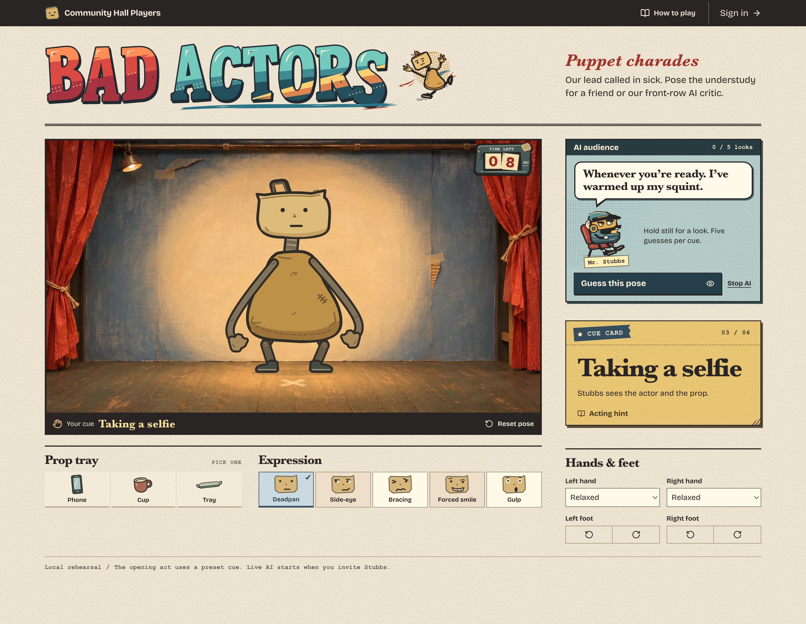

# Bad Actors

The community hall is one actor short. A canvas stage weight is covering the part. Pose the understudy so someone can guess what it is doing.

In the front row sits Mr. Stubbs, a ticket punch who takes himself seriously. Choose **Play with AI** to draw a surprise cue. You get 45 seconds to act it out, and he gets five looks. Pose the understudy and hold still. The battered clock on the curtain pauses while Stubbs thinks. At ten seconds the digits turn red and the loose tile slips. His guess appears in the balloon above his seat. When he misses he hides behind his programme. When he gets it he punches a star ticket. **What Stubbs saw** keeps the pictures and his exact guesses for the current round.

You can also guess the opening act yourself or take **Your turn** to play one of six cues with a friend. **Choose a cue** jumps straight to an exercise. **Acting hint** shows an achievable pose. **Hide cue** covers the slip and puts away both the hint and the cue list before you hand over the screen.

Try the two phone cues back to back. For a call, tuck the phone against an ear. For a selfie, drag the phone itself high and to one side. The wrist follows, the screen turns toward the actor and its eyes follow the phone. Give the empty hand a peace sign. Cup, phone and serving tray can all be picked up, carried and passed to the other hand.



[Six poses made on the stage](docs/verification/six-poses-2026-11-23/six-poses.png) · [Five-second cup and hand take](docs/sandbag-take.gif) · [Watch a foot pull the actor off balance](docs/leg-recoil.gif)

### Run the rehearsal

Use a supported Node 22.15+, 24 or 26 release with npm 11.6+.

```sh
npm ci
npm run practice
```

Open the local URL printed by Vite. This command starts free practice and pass-the-screen play. The local link http://127.0.0.1:5173/?cue=3 opens the selfie exercise directly. Keyboard players can tab to a handle and use the arrow keys. Hold Shift for larger steps.

For the live audience on the project Mac, double-click **Play-Bad-Actors.command** in Finder. Alternatively run:

```sh
npm run practice:ai
```

The launcher reads the operator's existing server-side profile. On another computer, set `BAD_ACTORS_AI_PROFILE` to an absolute path to a private env file outside the project with `OPENAI_BASE_URL` and `OPENAI_API_KEY`. The tested model is `gpt-6.2-sol`. Keep the terminal open during play.

Opening the game and drawing a cue are free. Hold a changed pose still or press **Guess this pose** to send it. For untimed rehearsal, choose a card yourself, then **Try this cue with AI**. One model call sees only the frozen actor and prop. A second call sees the assigned action and the first model's guess and scores their meaning. Each round permits five pictures, with daily limits of 12 per local browser session and 24 across the local app. Browsing the observation history reuses the results.

Grab any part of the actor on the same stage. Pull a boot sharply upward and let go. The knee folds, the hips shift and the neck catches up. Try the same pull at the shoulder to feel how the weight travels differently. Slow drags let you place a joint precisely. Either hand can open, close or make a V sign. Choose **Side-eye** or **Bracing** to see how the same pose reads with a different expression.

To compare the controls, open **How to play → Compare the feel**. Try lifting one hand, bringing the cup to the mouth, and stopping a quick wave in each mode. **Body follow** lets the torso and head settle after the hand stops. **Direct only** keeps the torso still.

```sh
npm run validate
npm run lint
npm run build:practice
```

### Project status

The single-player AI game runs locally through the configured third-party OpenAI-compatible service. In actual referee calls, Sol accepted both “make a call” and “call sombody” for the phone cue. The opening audience puzzle uses a fixed practice cue. In an earlier blind test Sol described the eye-covering pose as “Rubbing both eyes,” which prompted separate open-palm and fist controls. Hosted multiplayer and voice remain pending. The first DeepSpace deployment is waiting for app quota.

[Verification and receipts](docs/VERIFICATION.md) · [Implementation guide](docs/Bad_Actors_Codex_Plan.md)

### Where the actor came from

Canvas weights steady lighting stands and scenery. That gave the understudy its job, its lopsided shape and its predicament. The one thing employed to keep a stage steady can barely stay upright. The taped flats and single work light belong to the same community hall. [PRG’s stage weights](https://www.prg.com/-/media/Files/Australia/Stage-Fabrics/Shotbags_and_Sandbags.pdf) · [Theatre Calgary’s guide to *The Play That Goes Wrong*](https://www.theatrecalgary.com/assets/downloads/Play-Guides/The-Play-That-Goes-Wrong_TCPlay-Guide.pdf)

The five-second take gives the actor one ordinary job. Let it finish taking a sip before the other hand flies up. The still cup is how the audience can see the rest of the body struggling. That timing owes something to Jacques Tati’s determined postman and *Octodad*’s attempts at everyday tasks. [Criterion on *Jour de fête*](https://www.criterion.com/films/28114-jour-de-fete) · [Young Horses on *Octodad*](https://blog.playstation.com/?p=130022)

The shoulders react first, the weight lands on a boot and the head finishes a beat late. The eyes and mouth remain quiet enough that the audience can read the effort in the silhouette. [National Theatre’s puppet lesson on weight](https://www.youtube.com/watch?v=vXT3gPef8zo) · [Disney’s guide to follow-through](https://a.dolimg.com/media/en-US/disneyeducationalproductions/noma/pdf/DE1775_NOMA_TG.pdf)

### The printed programme

The title keeps its hand-cut letters. Coral and carmine ink fill BAD, turquoise and petrol blue fill ACTORS, and one amber spray mark catches the falling S. The lettering references New York wall pieces and the layered print marks in the Spider-Verse titles. A sharp pull leaves two short strokes behind the moving grip. The curtain and cardboard flats share an original image-generated backdrop. The articulated actor and its prop are separate from the scenery for dragging and for clean visual observations. [The Wild Style mural](https://www.mcny.org/event/new-york-film-wild-style) · [Spider-Verse title design](https://www.seojinbang.com/Spider-Man-Into-the-Spider-Verse) · [Pollock’s toy theatres](https://www.pollockstoymuseum.co.uk/post/toy-theatre-and-puppetry/)

Stubbs borrows the comic timing of an object trying to do its job. A bad guess is his opportunity to embarrass himself. The bubble carries the model's actual words; the captions and ticket gags belong to his performance. [Pixar’s Luxo Jr.](https://www.pixar.com/luxo-jr) · [Jackbox’s Drawful](https://www.jackboxgames.com/games/the-jackbox-party-pack-1/drawful)

The cue reads in ochre when the actor draws it, blue on the audience-facing reverse and pale green when the opening answer is revealed. The six exercise pictures double as a pose sheet: check the distance from a prop to the face, the line from shoulder to wrist and the actor’s balance. These decisions drew on Pixar’s use of color across story beats, Disney’s Mirabel pose drawings and the way the Hawkeye title artists separated arms and props to make a silhouette legible. [Lou Romano on the Incredibles color script](https://www.moma.org/audio/playlist/192/2575) · [Disney visual development](https://www.disneyanimation.com/process/visual-development/) · [Hawkeye title design interview](https://beforesandafters.com/2022/01/21/how-the-main-titles-of-hawkeye-helped-tell-the-story-of-kate-and-clint/)
