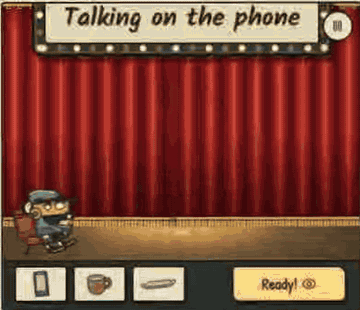
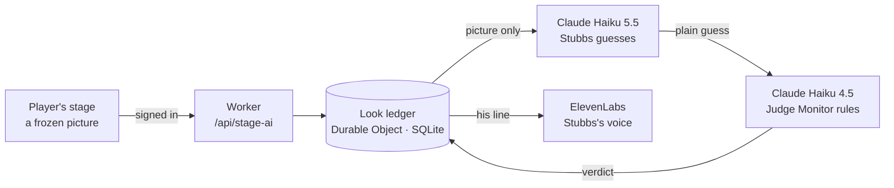
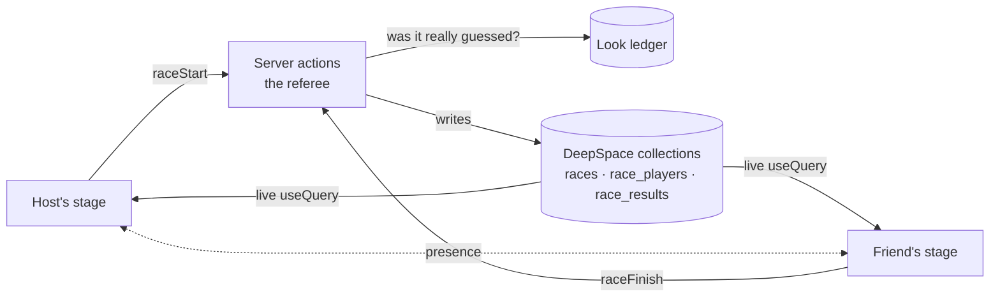
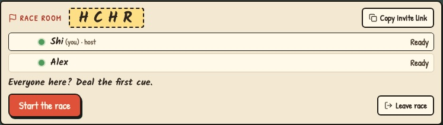

<p align="center">
  <a href="https://bad-actors-shi.app.space"></a>
</p>

<p align="center">
  <b>Puppet charades in a paper toy theatre where everything goes wrong.</b><br>
  You pose a sandbag understudy. Mr. Stubbs, an AI critic in the front row, guesses from a frozen picture.<br>
  Judge Monitor, the hall's old computer, prints the verdict.
</p>

<p align="center">
  <a href="https://bad-actors-shi.app.space"><b>▶ Play it live</b></a> ·
  <a href="#three-minutes-for-reviewers">Three-minute tour</a> ·
  <a href="#how-it-works">How it works</a> ·
  <a href="#how-it-was-built">How it was built</a> ·
  <a href="docs/VERIFICATION.md">Verification</a>
</p>

<p align="center">
  
  
  
  
</p>

<p align="center">
  
</p>

## Highlights

<table>
  <tr>
    <td width="50%" valign="top"><br><b>Learn by watching.</b> A silent glove plays a whole round before you read a word.</td>
    <td width="50%" valign="top"><br><b>The curtain is the countdown.</b> Every act opens on its cue in big letters, then the curtain parts.</td>
  </tr>
  <tr>
    <td valign="top"><br><b>Every hit is a show.</b> Streamers, a shower of used tickets and six spectators who clap out of time.</td>
    <td valign="top"><br><b>Race a friend.</b> Same cue on two stages. The server times the winner.</td>
  </tr>
  <tr>
    <td valign="top"><br><b>A puppet with weight.</b> Pull a boot and the knee folds, the hips shift and the head lands a beat late.</td>
    <td valign="top"><br><b>Stubbs guesses, the machine rules.</b> The guess comes from the picture alone; the verdict comes from a second, text-only judge.</td>
  </tr>
</table>

<sub>Captured from the game. The celebration comes from the free opening puzzle; the race uses two test accounts.</sub>

## Three minutes for reviewers

1. **Open the site.** A ten-second silent demo shows the whole loop, from the curtain opening on the cue to Stubbs’s guess. Choose **Let’s play! Sound on**.
2. **Free play → sign in → Talking on the phone.** Drag the actor’s hand to its ear, pick **Phone** from the prop tray and press **Ready! Guess, Stubbs**. Claude Haiku 5.5 guesses from the picture alone. Claude Haiku 4.5 rules on whether the guess means the cue, and ElevenLabs reads Stubbs’s heckle aloud.
3. **Timed show → Opening Night.** You get five 45-second acts and a curtain call. Guess three acts to open the next night, where props are flung from the wings, then come mood bonuses, blackouts and a heckler.
4. **Race a friend.** On the signed-in stage, open a race and send the four-letter code or link to a second account. Both stages get the same cue at the same moment; whoever makes Stubbs say it first wins, timed by the server.

### At a glance

| | |
| --- | --- |
| **Integrations** | Anthropic through DeepSpace handles the picture-only guess and the text-only referee. ElevenLabs gives Stubbs his voice. Speech-to-text was left out on purpose, because this is silent charades. |
| **Main tradeoff** | Each look costs two model calls: a blind guess, then a referee. That way Stubbs never sees the answer, and paraphrases are judged the same way every time. |
| **On DeepSpace** | Auth; the integration proxy; collections with per-row rules and live queries for race rooms, rosters, results and each player's best shows; a presence room per race; server actions as the race referee; a Durable Object as the ledger for paid looks. [Racing a friend](#racing-a-friend) |
| **Built with** | I chose the project (dropping my first one), wrote the first plan, designed the game, chose every reference, tested every screen and button by hand and approved every commit and deploy. Coding agents (Codex, then Claude Code) wrote most of the code and the automated tests under my direction. [How it was built](#how-it-was-built) |
| **Checked** | 227 unit tests, 44 Chromium stage tests, 12 DeepSpace tests on the local Worker (three with two real test accounts) and paid real-model checks. The latest covered the 12 new cues for $0.012. |
| **Not built** | Spectators, chat and a party mode where friends guess each other's poses. [What I’d do next](#not-built-and-what-id-do-next) |

## The feel I was going for

I play a lot of games, and I wanted Bad Actors to feel like one: something you want to poke, not a tidy app you put up with. That taste decided most of what you see.

- **Everything answers back.** A prop pops into the hand, a face boings, and a joint squeaks and wobbles when you tug it. The clock ticks only while you act. A hit brings streamers, a shower of used tickets and six spectators who clap out of time. A miss gets one half-hearted party horn.
- **Show, don't explain.** Like the hand demos before a party game, a silent glove plays a whole round before you read a word, then taps the way in.
- **Characters, not widgets.** The AI has a face and a voice I picked by ear. Stubbs breathes, yawns, hops on a hit and sweats on a miss. Judge Monitor beams, glitches red or fills with static.
- **Failure is part of the show.** Every night something goes wrong on purpose: stage fright, flying props, blackouts, a heckler, a curtain that sticks.
- **Handmade, not a dashboard.** Paper flats, hand-lettered type, ink and spray stand in for cards and grey buttons. Two big tickets replace a menu, and the cue arrives on a board of chasing bulbs after a drum roll.

## Where the ideas come from

The idea, the design and every reference below are mine. The agents built from them.

**Theatre**
- *The Play That Goes Wrong* gave the game its running joke: every night something on stage fails. The crooked fly board, the curtain that sticks, the blackout electrician and the flung props all come from it.
- [Pollock's paper toy theatres](https://www.pollockstoymuseum.co.uk/post/toy-theatre-and-puppetry/) set the look: cut-out flats, a paper proscenium and a printed programme.
- The understudy is a canvas stage weight, the thing that keeps a stage steady and can barely stay upright itself. The National Theatre's puppetry lesson on weight shaped how it moves: the shoulders react first and the head lands a beat late.

**Games**
- Draw-and-guess party games and Jackbox's *Drawful* gave the core loop: one player makes a picture, someone else guesses. Here the pencil is a puppet.
- *Paper Mario: The Thousand-Year Door* gave the front row: the audience sits in view, and the actor's hands and feet are never hidden behind the seats.
- *Papers, Please* put the verdict in a machine. Judge Monitor prints its ruling on a slip, as Lucas Pope's stamp desk does.
- *Octodad* showed how funny a body struggling at an everyday task can be.
- *红蓝大作战*, a two-player iPad party game, gave the silent how-to-play demo: a hand shows you where to touch before you read a word.
- Jackbox and Kahoot rooms, TypeRacer, Mario Kart and chess sites shaped the race: a room code to read out, a roster that fills in live, the same prompt for everyone, a countdown (here, the curtain) and one button for a rematch.

**Comics and lettering**
- Comic speech balloons give Stubbs his voice on the page: a balloon whose tail leads back to him, hand-lettered type and a line printed one letter at a time. [Blambot's lettering guide](https://blambot.com/pages/comic-book-grammar-tradition) set the rules.
- The *Wild Style* mural and New York wall pieces gave the hand-cut BAD ACTORS wordmark its colours and its spray mark.

**Film and animation**
- *Spider-Man: Into the Spider-Verse* and *Across the Spider-Verse* gave the layered print marks in the title, the two ink strokes a sharp drag leaves behind and the stage light.
- Pixar's colour scripts, after Lou Romano's work on *The Incredibles*, made the cue card's colour say whose turn it is. *Luxo Jr.* showed a machine body can act.
- *WALL·E*, and Andrew Stanton's account of finding its face in a pair of binoculars, let Judge Monitor act with its own parts.
- Disney's pose drawings for Mirabel and its guide to follow-through shaped the pose sheet and the actor's weight.
- Jacques Tati's postman in *Jour de fête* set the timing: finish the sip before the other hand flies up.
- *Mystery Science Theater 3000* kept the front-row silhouettes small enough to leave the show in view.
- The *Hawkeye* title sequence showed how separating arms and props makes a silhouette readable.

## The game

The community hall is one actor short, and a canvas stage weight is covering the part. Pose the understudy so Mr. Stubbs can guess what it is doing.

1. **Read the cue.** The curtain comes down and the cue hangs in front of it in big letters.
2. **Pose the puppet.** Drag a hand, a knee or the head. Pick from nine props, ten faces and seven hand shapes in the dressing room beside the stage; on a phone it docks to the bottom as four tabs.
3. **Press Ready.** Stubbs sees only a frozen picture and gets five looks a round. Judge Monitor prints the ruling on a slip.

**Free play** takes any of the 30 cues with no clock. The **timed show** deals five acts from one night, on that night's clock, and every night goes wrong in its own way. Guess three acts to open the next night. After the last act, the **curtain call** shows each frozen pose, what Stubbs said, stars for quick hits and his review of the night.

| Night | What goes wrong |
| --- | --- |
| **Opening Night** · the six classics | **Stage fright.** The understudy trembles and sweats until you grab it. |
| **The Prop Cupboard** · a toast, karaoke, an umbrella, a book… | **Catch!** Each act's prop is flung on from the wings and lands on the boards. Pick it up. |
| **Big Feelings** · waving, shrugging, falling in love, a tantrum… | **Feel it.** The card names a mood. Wear that face for the hit and earn a bonus star. |
| **Blackout Matinee** · hitchhiking, a bright idea, covering your ears… | **Lights out.** The hall keeps going dark. Only the actor's eyes glow while the electrician apologises. |
| **Heckler’s Gala** · a rose proposal, a banana phone, a rubber chicken… | **Heckler.** 30-second acts and a man in the balcony shouting wrong answers. |

With **Stage sound** on, Stubbs reads his lines in an ElevenLabs voice, the pit band plays each night's arrangement of an original music-hall tune, and every prop, face and joint makes its own noise. [Listen to the 11-second sound check](public/stage-soundcheck.mp3)

## How it works

### One look, two calls



Anyone can pose the actor and guess the opening puzzle. In the signed-in AI game, Mr. Stubbs sends a frozen picture of the actor and prop to DeepSpace’s managed Claude Haiku 5.5. His brief gives him a character, describes the puppet’s anatomy and asks for two lines: a plain guess and one remark in character. It names no cue. After a miss, the next look reminds him which guesses that round were ruled out, as a performer would shake their head. Judge Monitor makes a separate text-only request to Claude Haiku 4.5 at temperature 0 with the cue and the plain guess to check their meaning. With **Stage sound** on, ElevenLabs reads his remark aloud. Each look gets at most one clip, which the server keeps for repeat requests. The server allows five looks per round. This checkout budgets 60 daily looks per signed-in visitor and 240 shared across visitors. Setting STAGE_OWNER_OPEN_REHEARSAL to true removes the daily cap for the verified owner alone. The owner’s observations are accounted separately. A deployment applies this setting to the hosted game. Replay reads the saved guess.

Every model and voice call goes through DeepSpace’s integration proxy: `apiWorkerFetch` to `anthropic/chat-completion` and `elevenlabs/generate-speech` in [stage-provider.ts](src/server/stage-provider.ts). The app holds no provider keys, and the owner’s DeepSpace credits pay. The booth’s routes check the DeepSpace session and turn signed-out visitors away, as the docs ask of anything that triggers a paid call. A SQLite-backed Durable Object ([stage-game.ts](src/server/stage-game.ts)) keeps each player’s round, the daily look counts and the cached voice clips, so replaying a look reads the saved guess and its clip instead of paying again.

The booth keeps its own Durable Object rather than a collection because it decides spending. Every look checks three counters (the round's five, the player's 60 and the house's 240) and writes its receipt in one SQLite transaction before any paid call is made, and it keeps the voice clip. Everything players share lives in DeepSpace collections, described below.

Two integrations, on purpose. Speech-to-text would turn silent charades into a word game, so it stays out. Web search, image generation and email have nothing to add to a guess: the game is a frozen pose, a guesser and a judge. Splitting the guess from the ruling already costs two model calls a look, plus at most one voice clip.

In six independent blind calls on hand-posed frames, Claude Haiku 4.5 recognized the selfie and mistook the phone call for another selfie. It also read the covered eyes as a heavy load. [Six images and original model answers](docs/verification/managed-vision-2026-11-23.json) On the same frames, the shipped brief on Haiku 5.5 named the phone call, the covered eyes (as peekaboo), the surrender and the tray (as a baking dish), and the referee accepted all four. Across the prompt drafts, Haiku 5.5 read the surrender as stretching in 2 of 8 calls. [Every call, answer and cost](docs/verification/stubbs-haiku55-2026-11-23.json) · [Local Worker verification](docs/verification/hosted-stage-local.json)

[Verification and receipts](docs/VERIFICATION.md) · [My first build plan](docs/PLAN.md)

### Racing a friend



<p align="center"></p>

Charades is a party game, so the signed-in stage has a third ticket: **Race a friend**. It opens a room with a four-letter code, the way Jackbox and Kahoot rooms work. The code uses consonants only, so it can't spell a word. Two to six signed-in players join by link or code and watch the roster fill in. The host deals, and every stage gets the same cue at the same moment; the curtain is the countdown. While you act, the board shows each rival's progress live, as TypeRacer does ("Stubbs is looking · look 2"). The first player to make Stubbs say the cue wins, with ties going to fewer looks. After the results, the host deals the next round.

The race is built from DeepSpace's own parts:

- **Collections with per-row rules.** `races`, `race_players` and `race_results` ([race-schema.ts](src/schemas/race-schema.ts)) can be read by every signed-in player and written by no browser. Each board is three live `useQuery` subscriptions, so a join, a deal or a finish shows on every stage as soon as the server accepts it.
- **Server actions as the referee.** `raceCreate`, `raceJoin`, `raceStart` and `raceFinish` ([race.ts](src/actions/race.ts)) run with the caller's verified identity. The deal time is the server's clock. A finish counts only when the AI booth's own ledger shows this player's round on this cue, opened after the deal and closed by a correct ruling. The time runs from the deal to the Ready press of the winning look, so a slow model reply costs nobody. A finish claimed from the browser before Stubbs has guessed, or carried over from an earlier game, is refused, and asking twice returns the first time.
- **A presence room per race.** `usePresenceRoom` carries who is online and what each stage is doing. None of it is stored.
- **Best shows that follow the account.** Each signed-in player's best timed show per night lives in `show_bests`, which only its owner can read or write (`read: 'own'`, a server-bound user column and one row per night). Unlocked nights now follow the player to another device.

## How it was built

I built Bad Actors by directing coding agents, and every change went through me. I wrote the first plan, made every product decision, tested every screen and button by hand, and approved every commit and all 16 deploys. Every commit is in my name, and 17 of them also credit Claude as co-author. The agents wrote most of the code and the automated tests.

**Choosing the project.** My first build for this task was a meetup app I called Plan B. I built it, but it was a familiar forms-and-lists app that would have been hard to show: nothing in it a reviewer would remember. On November 23 I set it aside and started Bad Actors. I'd rather change course early than polish an idea that can't show what I can do.

**What I did**
- Wrote the first plan ([docs/PLAN.md](docs/PLAN.md)). Codex turned it into the first version of the code, adjusting details along the way.
- Designed the game and its world: a sandbag understudy in a community hall, Mr. Stubbs in the front row and Judge Monitor in the wings. I chose every reference above.
- Grew the game a request at a time. I asked for:
  - nine props, ten faces and seven hand shapes;
  - five nights that each go wrong in their own way;
  - the pit band and the sound effects;
  - characters that breathe and react between lines;
  - the silent demo, the opening curtain and the race.
- Tested every screen, button and flow by hand, on desktop and phone, before approving each deploy, and played the signed-in game on the live site. That is how I found:
  - returning players getting no sound;
  - a silent Safari tab;
  - a cue that was easy to miss;
  - the tutorial glove hidden behind the race ticket.
- Made the calls an agent can't: I picked Stubbs's voice by ear from five ElevenLabs voices and judged the music and sound by ear.
- Compared the build with DeepSpace's example apps. Every one keeps its data in collections and tests with two users, so I proposed racing the same cue, run the way established party games run their rooms.
- Approved every paid model check and kept them small.
- Caught the agents' mistakes. Their first Safari "fix" blamed `connect()`; a sound check I ran in my own Safari disproved that, and the shipped notes were corrected.

**What the agents did**
- Codex wrote the first version of the code from my plan.
- Claude Code wrote most of the later code under my direction, including the hosted AI booth, the race, the art and animation, and the synthesized music and sound. It also wrote the automated tests (227 unit, 44 browser and 12 DeepSpace) and kept [the verification log](docs/VERIFICATION.md).

## Not built, and what I’d do next

- **Races are small and live.** Two to six players, no spectators and no chat, and nothing kept beyond the room. Next I'd add a spectator seat and a weekly table of the fastest time per cue.
- **A party mode.** In charades, friends usually guess each other. The next step is a room where one player poses, the others race Stubbs to guess the frozen pose on their phones, and Judge Monitor rules on every answer.
- **A player who leaves mid-round.** The round waits for everyone's result. If a player closes the tab, the host can deal the next round anyway.
- **Stubbs isn't always right.** In the last real-model check he named 9 of 12 new cues on the first look, and the three misses needed new poses or names. I’d measure all 30 cues the same way.
- **Safari.** A long-open Safari tab once stayed silent with sound on. Two fixes shipped and sound came back, but the root cause is unconfirmed. [The notes](docs/VERIFICATION.md)
- **One pair of ears.** The music and effects are synthesized in code and only I have judged them.

## Run it locally

Use a supported Node 22.15+, 24 or 26 release with npm 11.6+.

```sh
npm ci
npm run practice
```

Open the local URL printed by Vite for the how-to-play demo, the posing controls and the opening puzzle. Without an AI profile the booth stays closed, so the two game tickets don’t appear. The local link http://127.0.0.1:5173/?cue=3 opens the selfie exercise directly. Keyboard players can tab to a handle and use the arrow keys. Hold Shift for larger steps.

For an AI audience on a developer machine, `npm run practice:ai` reads a private profile named by `BAD_ACTORS_AI_PROFILE`: an OpenAI-compatible base URL and key kept outside the repository. It is only a local rehearsal aid. The deployed game talks to DeepSpace’s integrations and nothing else.

Grab any part of the actor on the same stage. Pull a boot sharply upward and let go. The knee folds, the hips shift and the neck catches up. Try the same pull at the shoulder to feel how the weight travels differently. Slow drags let you place a joint precisely. Each hand has its own illustrated row of four shapes. If it is holding a prop, select the shape you want it to take when you put the prop down. Choose **Side-eye** or **Bracing** to see how the same pose reads with a different expression.

To compare the controls, open **How to play → Keyboard & movement → Compare the feel**. Try lifting one hand, bringing the cup to the mouth, and stopping a quick wave in each mode. **Body follow** lets the torso and head settle after the hand stops. **Direct only** keeps the torso still.

```sh
npm run validate
npm run lint
npm run build:practice
npm run test:stage
```

`npm run test:stage` plays the stage in Chromium against the loopback practice server, with every model reply scripted, so it bills nothing.

`npx deepspace test run e2e` runs the smoke, API and two-player specs against the local Worker. The two-player specs need two test accounts (`npx deepspace test accounts list`) and spend no model calls.

Deploy with `npx deepspace deploy`. `STAGE_AI_PROVIDER = "anthropic"` in `wrangler.toml` turns on the hosted booth.

## Repository layout

```text
.
├── src/
│   ├── rehearsal/     the stage: curtain, Stubbs, Judge Monitor, race board, sound and music
│   ├── puppet/        the jointed sandbag: rig, physics and drag handles
│   ├── server/        the AI booth: routes, the look ledger, model prompts
│   ├── actions/       server actions: the race referee
│   ├── schemas/       DeepSpace collections and their per-row rules
│   ├── pages/         routes: / (public stage), /room (signed in), /race
│   ├── components/    the error screen, page tags and toasts
│   ├── deck.ts        30 cues over five nights
│   └── race.ts        race rules shared by browser and server
├── tests/             Playwright: stage specs (practice server) and DeepSpace specs (two real users)
├── practice/          the offline practice server
├── scripts/           the local AI rehearsal and the paid probe tools
├── public/            art, fonts and sounds
├── docs/
│   ├── images/        pictures for this README
│   ├── verification/  receipts: model answers, costs and screenshots
│   ├── VERIFICATION.md
│   ├── DESIGN.md      why it looks, moves and sounds the way it does
│   └── PLAN.md        my first build plan
└── worker.ts          the Cloudflare Worker entry
```

More reading: [design notes](docs/DESIGN.md) · [verification log](docs/VERIFICATION.md) · [my first build plan](docs/PLAN.md)
