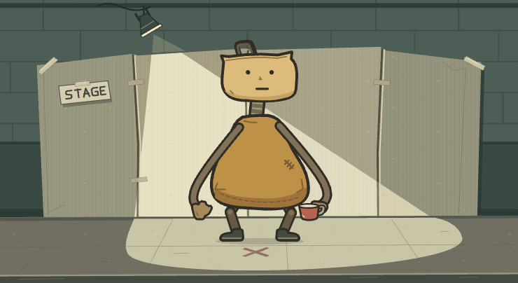

# Bad Actors

The community hall is one actor short. A canvas stage weight is covering the part. Pose the understudy so someone can guess what it is doing.

The current prototype is a free, local rehearsal. Guess the opening pose or choose **Your turn** to take the stage. Bring the cup to the actor's mouth, release that hand, then yank the empty hand straight up. Watch the knees and the head while the cup stays put. The prop tray also has a phone and a plate. **Next cue** cycles through six practice actions.

To playtest with someone beside you, read the cue privately, choose **Hide cue**, then show them your pose. Advancing to the next cue keeps its text hidden until you choose **Show cue**.



[Four poses made with the joint controls](docs/poses.jpg) · [Full rehearsal screen](docs/rehearsal.jpg)

### Run the rehearsal

Use a supported Node 22.15+, 24 or 26 release with npm 11.6+.

```sh
npm ci
npm run practice
```

Open the local URL printed by Vite. The practice entry uses the same stage as the DeepSpace landing page and runs without an account or provider credentials. Drag the head or either palm. Keyboard players can tab to a handle and use the arrow keys. Hold Shift for larger steps.

Grab any part of the actor on the same stage. Plant one boot, lift the other, pull the waist down, then tilt the head. The shoulders and elbows can move independently while a posed wrist keeps the cup steady. Use the hand shape controls for spread palms or fists, and turn either boot by its own controls. Choose **Side-eye** or **Bracing** to see how the same pose reads with a different expression.

To compare the controls, open **How to play → Compare the feel**. Try lifting one hand, bringing the cup to the mouth, and stopping a quick wave in each mode. **Body follow** lets the torso and head settle after the hand stops. **Direct only** keeps the torso still.

```sh
npm run validate
npm run lint
npm run build:practice
```

### Project status

This rehearsal follows a player test in which the original actor's torso barely moved and the cup covered its face. In a separate blind test through a third-party OpenAI-compatible API, Sol recognized drinking and a phone call. It guessed “Rubbing both eyes” for a pose meant to cover the eyes. That result led to separate open-palm and fist controls. The opening guess in the practice page uses a fixed demonstration cue. Live AI rounds, shared rooms, spoken guesses and replay are later milestones. The first DeepSpace deployment is pending the developer account’s app quota.

[Verification and receipts](docs/VERIFICATION.md) · [Implementation guide](docs/Bad_Actors_Codex_Plan.md)

### Where the actor came from

Canvas weights steady lighting stands and scenery. That gave the understudy its job, its lopsided shape and its predicament. The one thing employed to keep a stage steady can barely stay upright. The taped flats and single work light belong to the same community hall. [PRG’s stage weights](https://www.prg.com/-/media/Files/Australia/Stage-Fabrics/Shotbags_and_Sandbags.pdf) · [Theatre Calgary’s guide to *The Play That Goes Wrong*](https://www.theatrecalgary.com/assets/downloads/Play-Guides/The-Play-That-Goes-Wrong_TCPlay-Guide.pdf)

The five-second take gives the actor one ordinary job. Let it finish taking a sip before the other hand flies up. The still cup is how the audience can see the rest of the body struggling. That timing owes something to Jacques Tati’s determined postman and *Octodad*’s attempts at everyday tasks. [Criterion on *Jour de fête*](https://www.criterion.com/films/28114-jour-de-fete) · [Young Horses on *Octodad*](https://blog.playstation.com/?p=130022)

The shoulders react first, the weight lands on a boot and the head finishes a beat late. The eyes and mouth remain quiet enough that the audience can read the effort in the silhouette. [National Theatre’s puppet lesson on weight](https://www.youtube.com/watch?v=vXT3gPef8zo) · [Disney’s guide to follow-through](https://a.dolimg.com/media/en-US/disneyeducationalproductions/noma/pdf/DE1775_NOMA_TG.pdf)
