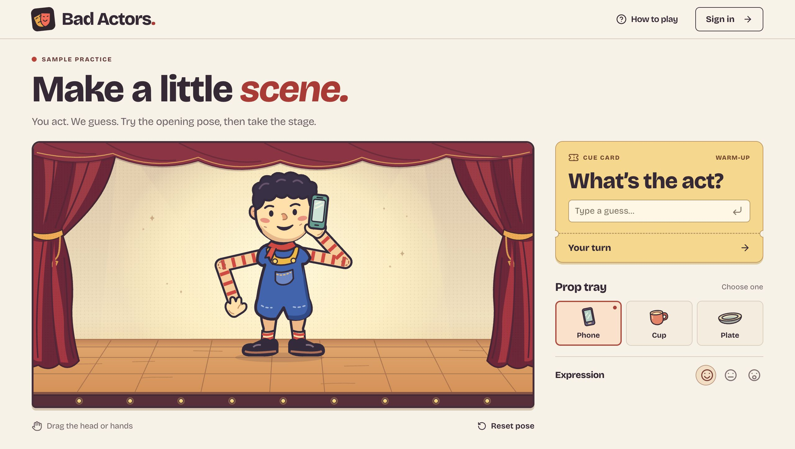

# Bad Actors

Make a little scene. Pose a two-dimensional actor so someone can guess what they are doing.

The current prototype is a free, local rehearsal. Guess the opening pose or choose **Your turn** to take the stage. Pick up the cup, bring it to the actor’s mouth and release the hand. It stays where you put it. The prop tray also has a phone and a plate. **Next cue** cycles through six practice actions.

To playtest with someone beside you, read the cue privately, choose **Hide cue**, then show them your pose. Advancing to the next cue keeps its text hidden until you choose **Show cue**.



### Run the rehearsal

Use a supported Node 22.15+, 24 or 26 release with npm 11.6+.

```sh
npm ci
npm run practice
```

Open the local URL printed by Vite. The practice entry uses the same stage as the DeepSpace landing page and runs without an account or provider credentials. Drag the head or either palm. Keyboard players can tab to a handle and use the arrow keys. Hold Shift for larger steps.

To compare the controls, open **How to play → Compare the feel**. Try lifting one hand, bringing the cup to the mouth, and stopping a quick wave in each mode. **Body follow** lets the torso and head settle after the hand stops. **Direct only** keeps the torso still.

```sh
npm run validate
npm run lint
npm run build:practice
```

### Project status

This is the first playtest. The opening guess uses a fixed demonstration cue. Live AI rounds, shared rooms, spoken guesses and replay are later milestones. DeepSpace refused the new application registration because the developer account had reached its app limit. The first DeepSpace deployment is pending.

[Verification and receipts](docs/VERIFICATION.md) · [Implementation guide](docs/Bad_Actors_Codex_Plan.md)
