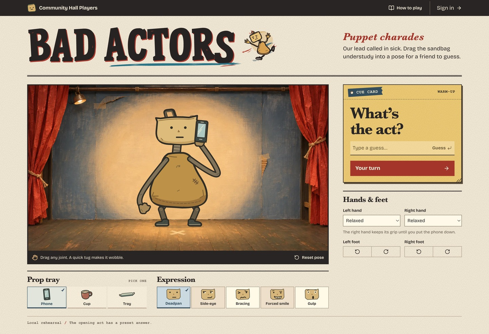

# Bad Actors

The community hall is one actor short. A canvas stage weight is covering the part. Pose the understudy so someone can guess what it is doing.

The opening act is a local guessing game. Take **Your turn** to work one of six cues. **Choose a cue** jumps straight to an exercise. **Acting hint** opens an image of an achievable pose and a stage direction. **Hide cue** covers the slip and removes the hint and the cue list before you hand the screen to someone.

Try the two phone cues back to back. For a call, tuck the phone against an ear. For a selfie, drag the phone itself high and to one side. The wrist follows, the screen turns toward the actor and its eyes follow the phone. Give the empty hand a peace sign. Cup, phone and serving tray can all be picked up, carried and passed to the other hand.



[Six poses made on the stage](docs/verification/six-poses-2026-11-23/six-poses.png) · [Five-second cup and hand take](docs/sandbag-take.gif) · [Watch a foot pull the actor off balance](docs/leg-recoil.gif)

### Run the rehearsal

Use a supported Node 22.15+, 24 or 26 release with npm 11.6+.

```sh
npm ci
npm run practice
```

Open the local URL printed by Vite. The practice entry uses the same stage as the DeepSpace landing page and runs without an account or provider credentials. Drag any joint. The local link http://127.0.0.1:5173/?cue=3 opens the selfie exercise directly. Keyboard players can tab to a handle and use the arrow keys. Hold Shift for larger steps.

Grab any part of the actor on the same stage. Pull a boot sharply upward and let go. The knee folds, the hips shift and the neck catches up. Try the same pull at the shoulder to feel how the weight travels differently. Slow drags let you place a joint precisely. Either hand can open, close or make a V sign. Choose **Side-eye** or **Bracing** to see how the same pose reads with a different expression.

To compare the controls, open **How to play → Compare the feel**. Try lifting one hand, bringing the cup to the mouth, and stopping a quick wave in each mode. **Body follow** lets the torso and head settle after the hand stops. **Direct only** keeps the torso still.

```sh
npm run validate
npm run lint
npm run build:practice
```

### Project status

This rehearsal follows a player test in which the original actor's torso barely moved and the cup covered its face. In a separate blind test through a third-party OpenAI-compatible API, Sol recognized drinking and a phone call. It guessed “Rubbing both eyes” for a pose meant to cover the eyes. That result led to separate open-palm and fist controls. The opening guess in the practice page uses a fixed demonstration cue. Live AI rounds, shared rooms, spoken guesses and replay are later milestones. The first DeepSpace deployment is pending the developer account’s app quota.

[Verification and receipts](docs/VERIFICATION.md) · [Implementation guide](docs/Bad_Actors_Codex_Plan.md)

### Where the actor came from

Canvas weights steady lighting stands and scenery. That gave the understudy its job, its lopsided shape and its predicament. The one thing employed to keep a stage steady can barely stay upright. The taped flats and single work light belong to the same community hall. [PRG’s stage weights](https://www.prg.com/-/media/Files/Australia/Stage-Fabrics/Shotbags_and_Sandbags.pdf) · [Theatre Calgary’s guide to *The Play That Goes Wrong*](https://www.theatrecalgary.com/assets/downloads/Play-Guides/The-Play-That-Goes-Wrong_TCPlay-Guide.pdf)

The five-second take gives the actor one ordinary job. Let it finish taking a sip before the other hand flies up. The still cup is how the audience can see the rest of the body struggling. That timing owes something to Jacques Tati’s determined postman and *Octodad*’s attempts at everyday tasks. [Criterion on *Jour de fête*](https://www.criterion.com/films/28114-jour-de-fete) · [Young Horses on *Octodad*](https://blog.playstation.com/?p=130022)

The shoulders react first, the weight lands on a boot and the head finishes a beat late. The eyes and mouth remain quiet enough that the audience can read the effort in the silhouette. [National Theatre’s puppet lesson on weight](https://www.youtube.com/watch?v=vXT3gPef8zo) · [Disney’s guide to follow-through](https://a.dolimg.com/media/en-US/disneyeducationalproductions/noma/pdf/DE1775_NOMA_TG.pdf)

### The printed programme

The title has two impressions of the same hand-cut lettering. Its last S has slipped, and the understudy sketched in the margin is reaching back for it. A blue scene pencil runs underneath. In the rehearsal, a strong pull leaves two short strokes behind the moving grip. They disappear when the player stops. The curtain and cardboard flats share an original image-generated backdrop. The articulated SVG actor and its prop sit in the open patch of stage light; they remain separate from the scenery for dragging and for clean visual observations. [Pollock’s toy theatres](https://www.pollockstoymuseum.co.uk/post/toy-theatre-and-puppetry/) · [Mischief’s show poster](https://www.mischiefcomedy.com/whats-on/the-play-that-goes-wrong/) · [Imageworks on drawing movement in Into the Spider-Verse](https://www.imageworks.com/our-craft/feature-animation/movies/spider-man-spider-verse) · [Aurélien Predal’s lighting keys for Across the Spider-Verse](https://www.aurelien-predal.com/across-spiderverse)

The cue reads in ochre when the actor draws it, blue on the audience-facing reverse and pale green when the opening answer is revealed. The six exercise pictures double as a pose sheet: check the distance from a prop to the face, the line from shoulder to wrist and the actor’s balance. These decisions drew on Pixar’s use of color across story beats, Disney’s Mirabel pose drawings and the way the Hawkeye title artists separated arms and props to make a silhouette legible. [Lou Romano on the Incredibles color script](https://www.moma.org/audio/playlist/192/2575) · [Disney visual development](https://www.disneyanimation.com/process/visual-development/) · [Hawkeye title design interview](https://beforesandafters.com/2022/01/21/how-the-main-titles-of-hawkeye-helped-tell-the-story-of-kate-and-clint/)
